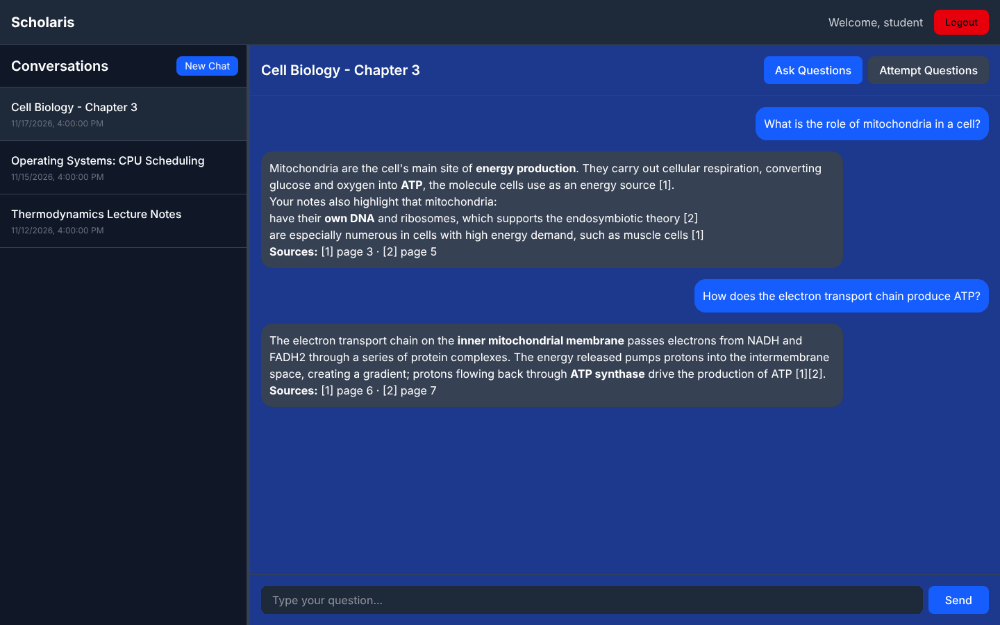
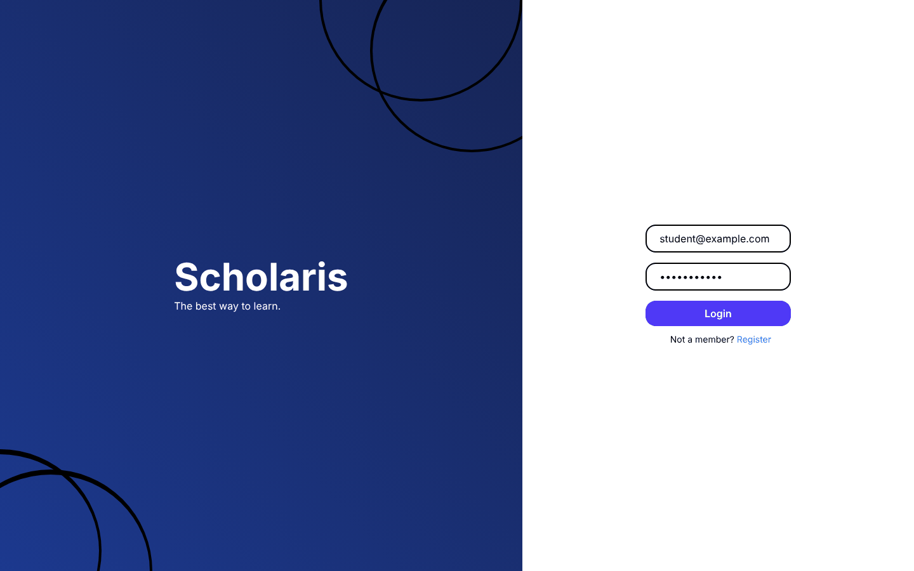
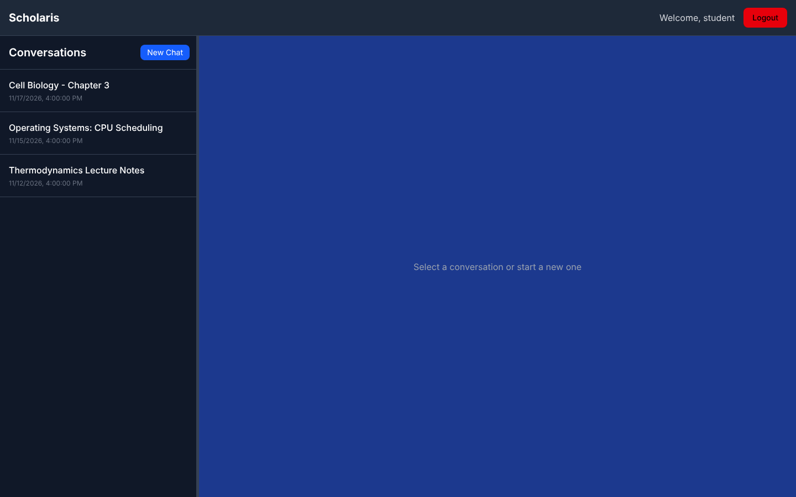
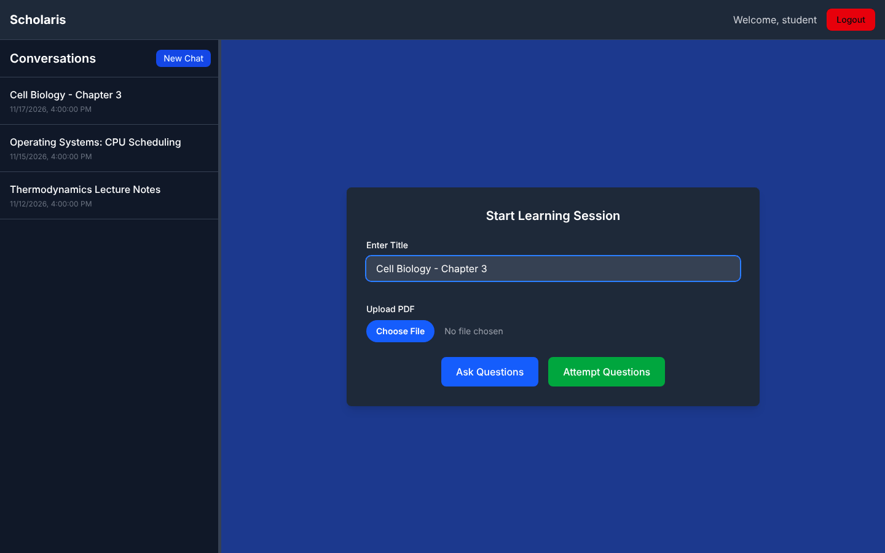
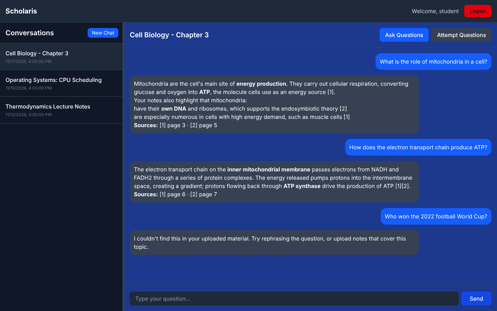
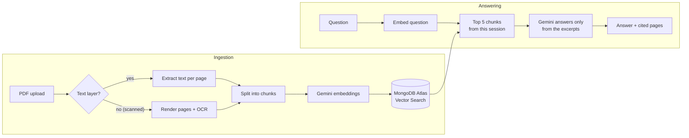

# Scholaris

**An AI study assistant that answers questions from your own notes.** Upload your study material as PDFs, ask questions, and get answers that come only from that material, with the page each answer came from.



## Features

- **Ask questions about your own material.** Each study session has its own PDFs, and answers only use those.
- **Answers cite their sources.** Every claim is tied to a numbered excerpt, and the cited pages are listed under the answer.
- **Honest when it doesn't know.** If your notes don't cover a question, Scholaris says so instead of guessing.
- **Works with scanned notes.** PDFs that are only images are read with OCR.
- **Private by design.** Every request is tied to the signed-in user, and nobody can query someone else's sessions.

## Screenshots

> The screenshots show the real React client, with sign-in and API responses replaced by sample data.

| | |
| --- | --- |
|  **Sign in** with email and password (Firebase Authentication). |  **Study sessions**, one per topic or set of notes. |
|  **Start a session** by naming it and uploading a PDF. |  **Out-of-scope questions** get an honest "not in your material" instead of a made-up answer. |

## How it works



1. **Upload:** the PDF is saved on the server and linked to a learning session owned by the signed-in user.
2. **Extract:** text is read page by page. If a PDF looks scanned (almost no text), each page is rendered and read with OCR (MuPDF + Tesseract).
3. **Chunk and embed:** pages are split into 1,000-character chunks with 150 characters of overlap, embedded with Gemini, and stored with their session ID and page number.
4. **Answer:** a question retrieves the 5 most similar chunks *from that session only*. Gemini answers using only those numbered excerpts, cites them as [1], [2]…, and says so when the material doesn't cover the question. If nothing relevant is retrieved, the model isn't called at all.

## Tech stack

| Layer | Technology | Why |
| --- | --- | --- |
| Front end | React, Vite, Tailwind CSS, React Router | Fast single-page chat interface |
| Answer rendering | react-markdown, rehype-mathjax | Answers can include formatting and formulas |
| Authentication | Firebase Authentication (client), firebase-admin (server) | Sign-in without storing passwords; the server verifies every request's token |
| API | Node.js, Express, multer | REST API and PDF uploads |
| Database | MongoDB with Mongoose | Users, sessions and chat history |
| Retrieval | MongoDB Atlas Vector Search | Similarity search over chunks, filtered per session, in the same database |
| AI | Google Gemini via LangChain | Embeddings and grounded answers |
| PDF processing | pdf-parse (LangChain PDFLoader), MuPDF, Tesseract.js | Text extraction with page numbers, and OCR for scanned PDFs |

## Security

- Every API route requires a Firebase ID token (`Authorization: Bearer <token>`); the server takes the user's identity from the verified token, never from the request.
- Sessions can only be read or queried by the user who created them.
- The server finds an uploaded file from the session record, never from a file name sent by the client, and only accepts PDFs up to `MAX_UPLOAD_MB`.
- Secrets live in `server/.env`, which is git-ignored. See `server/.env.example`.

## Getting started

### 1. MongoDB Atlas

Create a cluster and an Atlas Vector Search index named `vector_index` on the `rags` collection, using [`server/atlas-vector-index.json`](server/atlas-vector-index.json). The `learningSessionId` filter field is required: it keeps each session's search separate.

### 2. Server

```bash
cd server
cp .env.example .env      # then fill in MONGO_URI, GOOGLE_API_KEY, FIREBASE_PROJECT_ID
npm install
npm run dev               # or: npm start
npm test                  # unit tests; no database or API keys needed
```

### 3. Client

```bash
cd client
npm install
npm run dev               # http://localhost:5173
```

Set `VITE_API_URL` in `client/.env` if the API isn't at `http://localhost:5000`. The Firebase web config in `client/src/firebase.js` is public by design; access is protected by token verification on the server.

## Project structure

```
Scholaris/
├── client/                    # React + Vite front end
│   └── src/
│       ├── api.js             # API client: base URL + sign-in token on every request
│       ├── pages/             # Login, Study (chat), User
│       └── components/        # Sidebar, new-session form, navbar
├── server/                    # Express API
│   ├── app.js / index.js      # App setup, error handling, startup
│   ├── config.js              # Settings from server/.env
│   ├── routes/ controller/    # HTTP routes and handlers
│   ├── middleware/            # Auth, session ownership, PDF processing, retrieval
│   ├── models/                # Mongoose models
│   ├── pdfextraction.js       # OCR for scanned PDFs
│   ├── atlas-vector-index.json
│   └── test/                  # Unit tests (node:test)
└── docs/screenshots/
```

## Roadmap

- Process uploads in a background job queue instead of during the request.
- Generate practice questions for the "Attempt Questions" mode.
- Build an evaluation set to tune chunk size and top-k, and add hybrid (keyword + vector) search with reranking.
